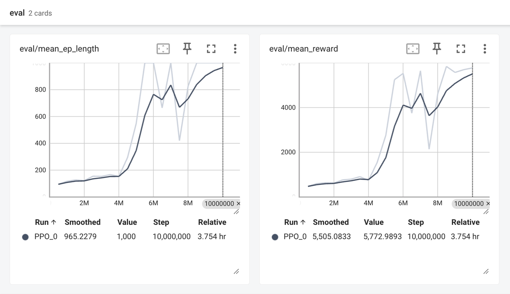
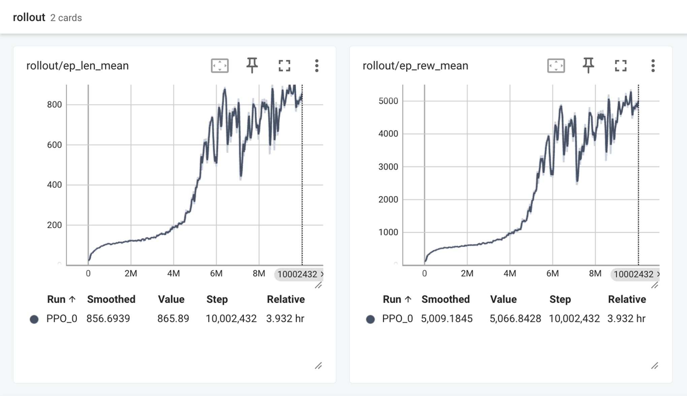
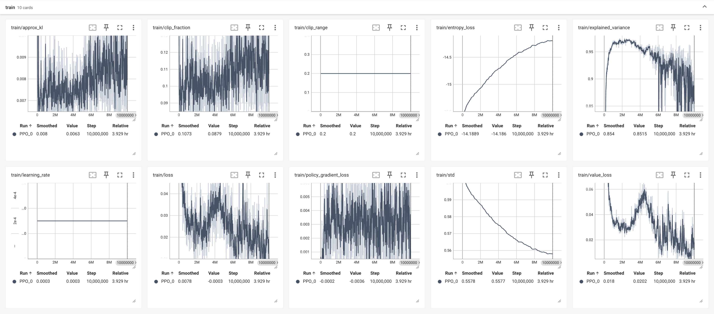

# 🧟 The Walking Dead 🧟

### 🤖 A practice project for Gymnasium & MuJoCo

> **CartPole:** Gymnasium의 CartPole-v1 환경에서 REINFORCE(정책 경사) 알고리즘을 PyTorch로 구현한 실습<br>
> **Humanoid:** Stable-Baselines3 PPO로 MuJoCo Humanoid-v4의 2족 보행을 학습하고 시연

<br>

[영상이 보이지 않는 경우 다운로드 링크 (/assets/humanoid_model_v1.mp4)](./assets/humanoid_model_v1.mp4)

https://github.com/user-attachments/assets/abe50e18-b7f0-49a7-ab97-fbbcece478ab

[영상이 보이지 않는 경우 다운로드 링크 (/assets/humanoid_model_v2.mp4)](./assets/humanoid_model_v2.mp4)

https://github.com/user-attachments/assets/746315c7-7723-4d7b-958f-a06838c02400

---

### 💻 Environment
#### 1. CartPole (2026-06-24)
- Intel Mac 기준, torch 버전은 환경에 따라 조정 필요
- macOS Sonoma
- Python 3.11

```bash
pip install "gymnasium[classic-control]" torch tensorboard
```


#### 2. Humanoid V1 (2026-06-28)
- Intel Mac으로 실행 시도했으나 학습 시간이 너무 오래 걸려 Kaggle Notebook으로 전환
- Kaggle Notebook (GPU T4 x2)
- OS: Linux-6.12.90+-x86_64-with-glibc2.35
- Python: 3.12.13
- Stable-Baselines3: 2.9.0
- PyTorch: 2.10.0+cu128
- Numpy: 2.4.6
- Cloudpickle: 3.1.2
- Gymnasium: 1.2.0
- OpenAI Gym: 0.26.2

> 학습 로그
```
----------------------------------------
| rollout/                |            |
|    ep_len_mean          | 96.8       |
|    ep_rew_mean          | 503        |
| time/                   |            |
|    fps                  | 1013       |
|    iterations           | 306        |
|    time_elapsed         | 4946       |
|    total_timesteps      | 5013504    |
| train/                  |            |
|    approx_kl            | 0.02603971 |
|    clip_fraction        | 0.206      |
|    clip_range           | 0.2        |
|    entropy_loss         | -19        |
|    explained_variance   | 0.959      |
|    learning_rate        | 0.0003     |
|    loss                 | 140        |
|    n_updates            | 3050       |
|    policy_gradient_loss | -0.0182    |
|    std                  | 0.756      |
|    value_loss           | 276        |
----------------------------------------
```
> **소요시간:** 1h 23m 25s<br>
> **총 스텝:** 5,013,504 (8개 환경 병렬)<br>
> **알고리즘:** PPO (SB3 MlpPolicy, 기본 네트워크 구조)<br>
> **결과:** 겨우 한두 걸음 떼는 수준


#### 3. Humanoid V2: VecNormalize 적용 (2026-10-19)
- Kaggle Notebook (4-Core CPU)
- OS: Linux-6.18.48+-x86_64-with-glibc2.39
- Python: 3.13.15
- Stable-Baselines3: 2.9.0
- PyTorch: 2.11.0+cpu
- Numpy: 2.1.3
- Cloudpickle: 3.1.2
- Gymnasium: 1.2.0
- OpenAI Gym: 0.26.2

```bash
!pip install -q "stable-baselines3[extra]" "gymnasium[mujoco]" mujoco
```

> 학습 로그
```bash
!python humanoid_v2_train.py --steps 10000000 --max_hours 11 --device cpu
```
```
------------------------------------------
| eval/                   |              |
|    mean_ep_length       | 1e+03        |
|    mean_reward          | 5.77e+03     |
| time/                   |              |
|    total_timesteps      | 10000000     |
| train/                  |              |
|    approx_kl            | 0.0062839924 |
|    clip_fraction        | 0.0879       |
|    clip_range           | 0.2          |
|    entropy_loss         | -14.2        |
|    explained_variance   | 0.852        |
|    learning_rate        | 0.0003       |
|    loss                 | -0.00031     |
|    n_updates            | 1223         |
|    policy_gradient_loss | -0.00363     |
|    std                  | 0.558        |
|    value_loss           | 0.0202       |
------------------------------------------
```
> **소요시간:** 3h 57m 27s<br>
> **총 스텝:** 10,002,432<br>
> **알고리즘:** PPO (SB3 MlpPolicy, 커스텀 구조: pi/vf 각각 256×256, ortho_init=True, log_std_init=-0.5)<br>
> **결과:** 기지개 켜다 똥매려운 듯 다급하게 종종걸음. 일단 걸을 수 있다!





> 평가 로그
```
episode  1/3  reward=5847.0  length=1000
episode  2/3  reward=5934.1  length=1000
episode  3/3  reward=5716.7  length=1000

===== 결과 =====
reward 평균: 5832.6 ± 89.3
length 평균: 1000 (최대 1000)
```

---

### 📂 Directory
```
├── assets/...                    # README images (렌더링 영상 포함)
├── models/
│   ├── cartpole_model.pth        # CartPole 모델 가중치 파일
│   ├── final_model.zip           # Humanoid V2 학습 종료 모델 가중치
│   ├── final_vecnormalize.pkl    # Humanoid V2 학습 종료 시점의 관측 정규화 통계
│   └── humanoid_model_v1.zip     # Humanoid V1 학습 모델 가중치
├── src/
│   ├── logs/                     # 학습 시 생성 TensorBoard 로그 결과물 (GitHub 관리 제외)
│   ├── cartpole/
│   │   ├── cartpole_test.py      # CartPole 강화학습 시연 스크립트
│   │   └── cartpole_train.py     # CartPole 강화학습 학습 스크립트
│   └── humanoid/
│       ├── humanoid_v1_test.py   # 저장된 모델을 불러와 렌더링 시연 (V1)
│       ├── humanoid_v1_train.py  # 기본 PPO 학습 (500만 스텝, VecNormalize 미적용)
│       ├── humanoid_v2_test.py   # 저장된 모델을 불러와 렌더링 시연 (V2)
│       └── humanoid_v2_train.py  # 본격 Humanoid 학습 스크립트 (1000만 스텝)
├── .gitignore
└── README.md
```
