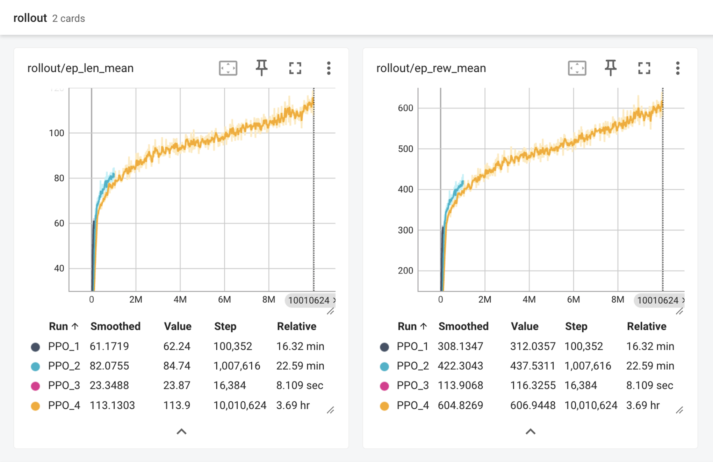
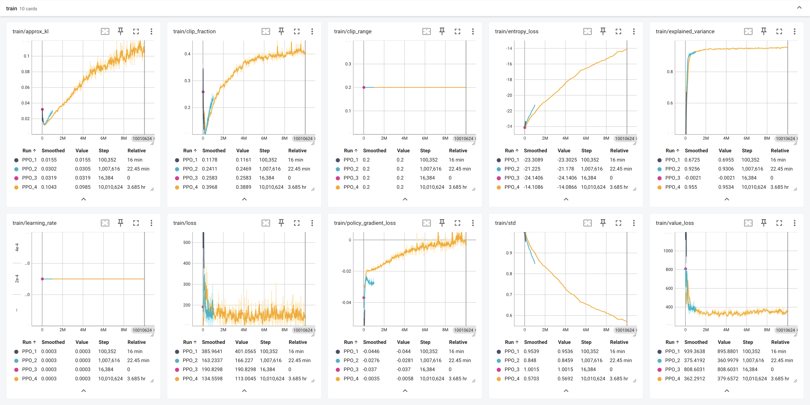
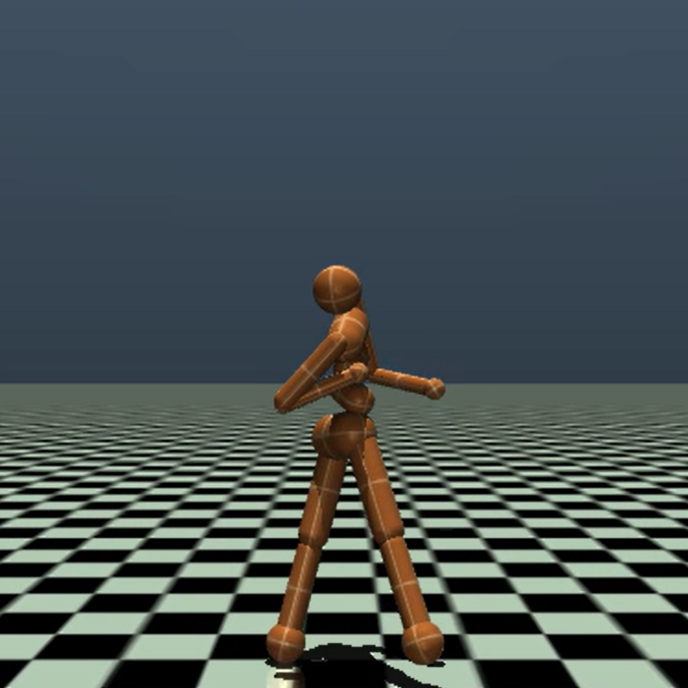

# 🧟 The Walking Dead 🧟

### 🤖 A practice project for Gymnasium & MuJoCo

> **CartPole:** Gymnasium의 CartPole-v1 환경에서 REINFORCE(정책 경사) 알고리즘을 PyTorch로 구현한 실습<br>
> **Humanoid:** Stable-Baselines3 PPO로 MuJoCo Humanoid-v4의 2족 보행을 학습하고 시연

<br>

[영상이 보이지 않는 경우 다운로드 링크 (/assets/humanoid_test.mp4)](./assets/humanoid_test.mp4)
<p align="left">
  <video src="https://github.com/user-attachments/assets/93f640e0-0aeb-4848-8d86-9baf5af5e447" width="50%" controls autoplay muted loop>
    Your browser does not support the video tag.
  </video>
</p>

---

### 💻 Environment
#### 1. CartPole (2026-06-24)
- Intel Mac 기준, torch 버전은 환경에 따라 조정 필요
- macOS Sonoma
- Python 3.11
```bash
pip install "gymnasium[classic-control]" torch
```



#### 2. Humanoid (2026-06-28)
- Intel Mac으로 실행 시도했으나 GPU 부재로 학습 시간이 너무 오래 걸려 Kaggle Notebook으로 전환
- Kaggle Notebook (GPU T4 x2)
- Runtime: 1h 23m 25s
- 총 스텝: 5,013,504 (목표 5,000,000 8개 환경 병렬)
- 최종 로그
```
----------------------------------------
| rollout/                |            |
|    ep_len_mean          | 96.8       |
|    ep_rew_mean          | 503        |
| time/                   |            |
|    fps                  | 1013       |
|    iterations           | 306        |
|    time_elapsed         | 4946       |
|    total_timesteps      | 5013504    |
| train/                  |            |
|    approx_kl            | 0.02603971 |
|    clip_fraction        | 0.206      |
|    clip_range           | 0.2        |
|    entropy_loss         | -19        |
|    explained_variance   | 0.959      |
|    learning_rate        | 0.0003     |
|    loss                 | 140        |
|    n_updates            | 3050       |
|    policy_gradient_loss | -0.0182    |
|    std                  | 0.756      |
|    value_loss           | 276        |
----------------------------------------
```


---

### 📂 Directory
```
├── .venv/...                    # (excluded from GitHub)
├── assets/...                   # README images
├── models/
│   ├── cartpole_model.pth       # CartPole 모델 가중치 파일
│   ├── humanoid_model_v1.zip    # humanoid_train으로 학습한 PPO 최종 모델 가중치
│   └── humanoid_model_v2.zip    # humanoid_train으로 학습한 PPO 최종 모델 가중치
├── src/
│   ├── logs/                    # CartPole 학습 시 생성 TensorBoard 로그 결과물
│   ├── cartpole/
│   │   ├── cartpole_test.py     # CartPole 강화학습 시연 스크립트
│   │   └── cartpole_train.py    # CartPole 강화학습 학습 스크립트
│   └── humanoid/
│       ├── humanoid_ppo_sb3.py  # 본격 Humanoid 학습 스크립트 (3000만 스텝 목표)
│       ├── humanoid_test.py     # 저장된 모델을 불러와 렌더링 시연
│       └── humanoid_train.py    # 기본 PPO 학습 (500만 스텝, VecNormalize 미적용)
├── .gitignore
├── pyproject.toml               # project configuration & dependencies
├── README.md
└── uv.lock                      # dependency lock file (excluded from GitHub)
```
